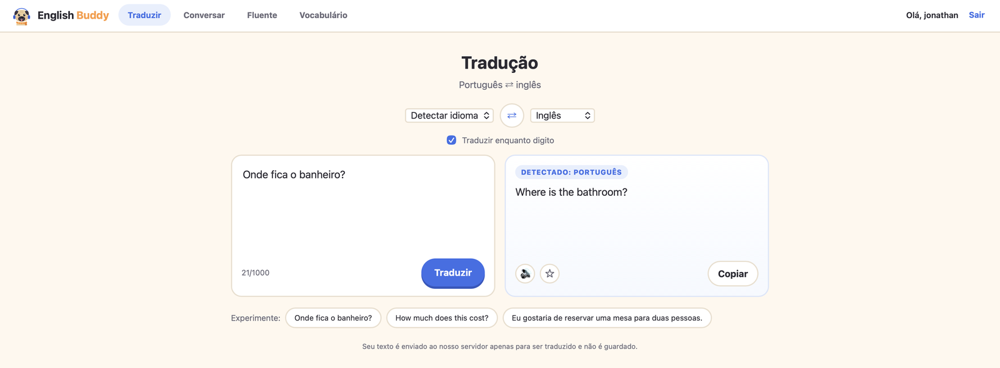
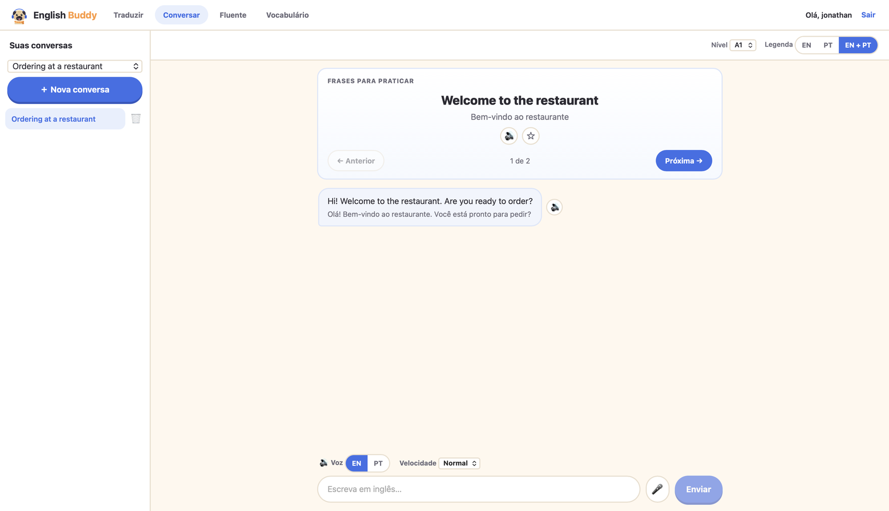
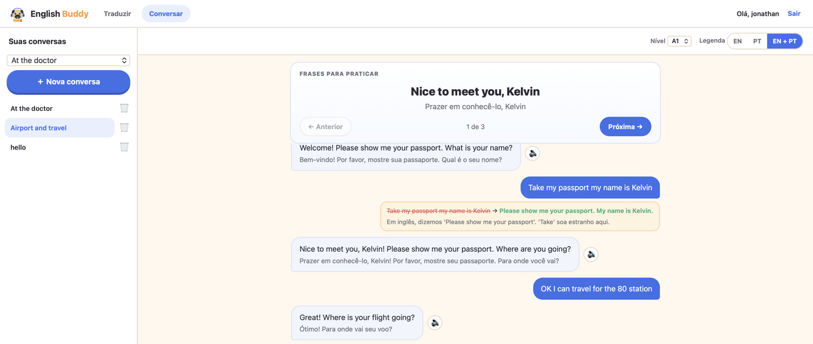
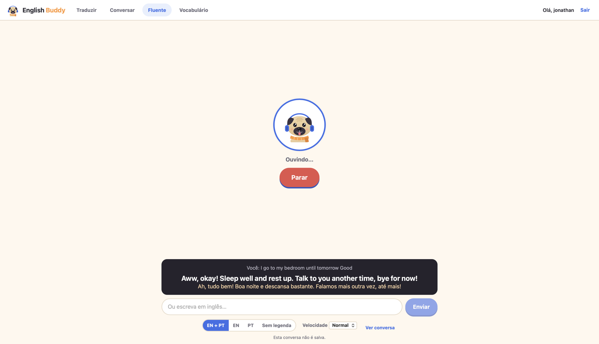
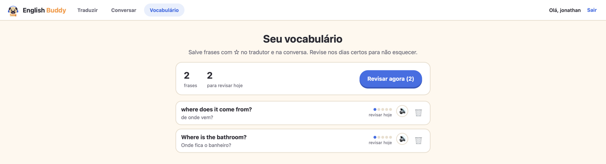

# 🐶 English Buddy

Assistente para praticar inglês com **IA rodando localmente** (Ollama). Traduz, conversa corrigindo seus erros, conversa por voz e monta um vocabulário com revisão espaçada. Funciona sem conta para testar; com conta, salva suas conversas e frases.



## Funcionalidades

- **Tradução** português ⇄ inglês com detecção de idioma e tradução automática enquanto você digita.
- **Conversar** com correções: a IA responde em inglês, corrige sua frase, explica o erro em português e sugere frases para praticar (cartões). Se não entender o que você escreveu, ela avisa em vez de adivinhar.
- **Cenários do dia a dia** (restaurante, aeroporto, hotel…): a IA puxa o assunto e você responde.
- **Fluente**: conversa por voz, como falar com uma pessoa, com legendas em inglês, português ou ambos. Tolera pausas na sua fala.
- **Vocabulário** com repetição espaçada (método Leitner, 5 caixas): salve frases com ⭐ e revise no tempo certo.
- **Voz**: ouvir qualquer resposta (🔊) e falar em vez de digitar (🎤), com velocidade ajustável.
- **Níveis** A1–C1 e legenda EN / PT / EN + PT.
- **Visitante**: Tradução, Conversar e Fluente funcionam sem login (sem guardar nada, com limite de uso por IP). Histórico e Vocabulário exigem conta.

### Conversa com cenário


### Correção da IA


### Fluente (conversa por voz)


### Vocabulário


## Tecnologias

- **Backend:** Python, FastAPI, SQLAlchemy 2, Pydantic v2, JWT (HS256) + bcrypt
- **Banco:** MySQL (`english_buddy`)
- **Frontend:** React 19 + Vite, React Router, Axios
- **IA:** [Ollama](https://ollama.com) com modelo local (camada de IA trocável)
- **Voz:** Web Speech API do navegador (síntese e reconhecimento)
- **Testes:** pytest

## Como a IA funciona

O backend fala com a IA por uma interface (`ProvedorIA`); hoje há uma implementação para o Ollama, e trocar de provedor não mexe no resto do código. Toda resposta segue um contrato JSON:

```json
{ "entendi": true, "correcao": "...", "en": "...", "pt": "...", "frases": [] }
```

O prompt é montado por nível e cenário. A resposta é validada com Pydantic e, se vier inválida, há uma nova tentativa. O histórico enviado ao modelo é limitado às últimas 12 mensagens. A IA fica atrás de um semáforo (2 requisições simultâneas) e as rotas públicas têm limite por IP.

Modelos testados: `Ornith 1.5 9B` (funciona, mas erra mais ao corrigir) e `Ornith 1.5 35B-A3B` (bem melhor; roda inteiro em uma RTX 5060 Ti de 16 GB).

## Estrutura

```
english-buddy/
├── backend/
│   ├── app/
│   │   ├── ia/            # provedor, prompts, validação, serviço
│   │   ├── routers/       # auth, conversas, publico, vocabulario
│   │   └── models.py, schemas*.py, security.py, limites.py, config.py, main.py
│   ├── tests/
│   ├── .env.example
│   └── requirements.txt
├── database/
│   └── schema.sql         # cria o banco e as tabelas
├── frontend/
│   └── src/               # api, auth, componentes, paginas, utils
└── docs/                  # imagens do README
```

## Pré-requisitos

- Python 3.11+
- Node 20+
- MySQL 8+ (ou MariaDB 10.5+)
- Ollama com um modelo baixado, por exemplo:
  ```bash
  ollama pull hf.co/ornith-ai/Ornith-1.5-9B-GGUF:latest
  ```

## Como rodar

**1. Banco de dados**

```bash
mysql -u root -p < database/schema.sql
```

**2. Backend**

```bash
cd backend
python3 -m venv .venv
source .venv/bin/activate
pip install -r requirements.txt
cp .env.example .env      # edite com seus dados
uvicorn app.main:app --reload
```

API em `http://localhost:8000` (docs em `/docs`).

**3. Frontend**

```bash
cd frontend
npm install
npm run dev
```

Abra `http://localhost:5173`.

## Variáveis de ambiente (`backend/.env`)

| Variável | Descrição | Padrão |
|---|---|---|
| `DB_HOST` / `DB_PORT` | Servidor MySQL | `localhost` / `3306` |
| `DB_USER` / `DB_PASSWORD` / `DB_NAME` | Credenciais e banco | — |
| `JWT_SECRET` | Chave para assinar tokens (use um valor longo e aleatório) | — |
| `JWT_EXPIRA_MINUTOS` | Validade do login | `1440` |
| `OLLAMA_URL` | Endereço do Ollama | `http://127.0.0.1:11434` |
| `OLLAMA_MODEL` | Nome do modelo | — |
| `IA_PROVEDOR` | Provedor de IA | `ollama` |

> O `.env` nunca vai para o Git. Reinicie o backend depois de alterá-lo.

### Ollama em outra máquina (opcional)

Dá para rodar o modelo em um computador com GPU e usar o backend em outro: no servidor, configure `OLLAMA_HOST=0.0.0.0:11434` e aponte `OLLAMA_URL` para o IP dele. **Nunca exponha a porta 11434 na internet** (o Ollama não tem autenticação); use apenas rede local.

## Endpoints

| Método | Rota | Descrição | Login |
|---|---|---|---|
| POST | `/auth/cadastro` | Criar conta | — |
| POST | `/auth/login` | Entrar (JWT) | — |
| GET | `/auth/eu` | Dados do usuário | ✅ |
| PATCH | `/auth/preferencias` | Nível, voz, legenda, velocidade | ✅ |
| POST | `/publico/traduzir` | Traduzir | — |
| POST | `/publico/conversar` | Conversa sem histórico | — |
| POST | `/publico/abertura` | Abertura de cenário | — |
| POST | `/publico/fluente` | Conversa por voz | — |
| GET | `/cenarios` | Lista de cenários | — |
| GET / POST | `/conversas` | Listar / criar conversas | ✅ |
| GET / DELETE | `/conversas/{id}` | Abrir / apagar conversa | ✅ |
| POST | `/conversas/{id}/mensagens` | Enviar mensagem | ✅ |
| POST | `/conversas/{id}/abertura` | Abertura do cenário | ✅ |
| GET / POST | `/vocabulario` | Listar / salvar frase | ✅ |
| GET | `/vocabulario/revisao` | Frases para revisar hoje | ✅ |
| POST | `/vocabulario/{id}/revisar` | Registrar acerto ou erro | ✅ |
| DELETE | `/vocabulario/{id}` | Remover frase | ✅ |
| GET | `/saude` | Verifica API e banco | — |

## Repetição espaçada

Cada frase começa na caixa 1. Ao acertar, sobe de caixa e a próxima revisão fica mais distante (1, 3, 7, 14 e 30 dias). Ao errar, volta para a caixa 1 e reaparece no dia seguinte. Limite de 500 frases por usuário.

## Testes

```bash
cd backend
source .venv/bin/activate
python -m pytest -q tests
```

## Notas

- O reconhecimento de voz depende do navegador (Chrome e Safari funcionam; no Safari o áudio só libera após um toque).
- O Fluente ainda não salva histórico.
- Se o servidor de IA estiver desligado, a API responde `502` em poucos segundos.
